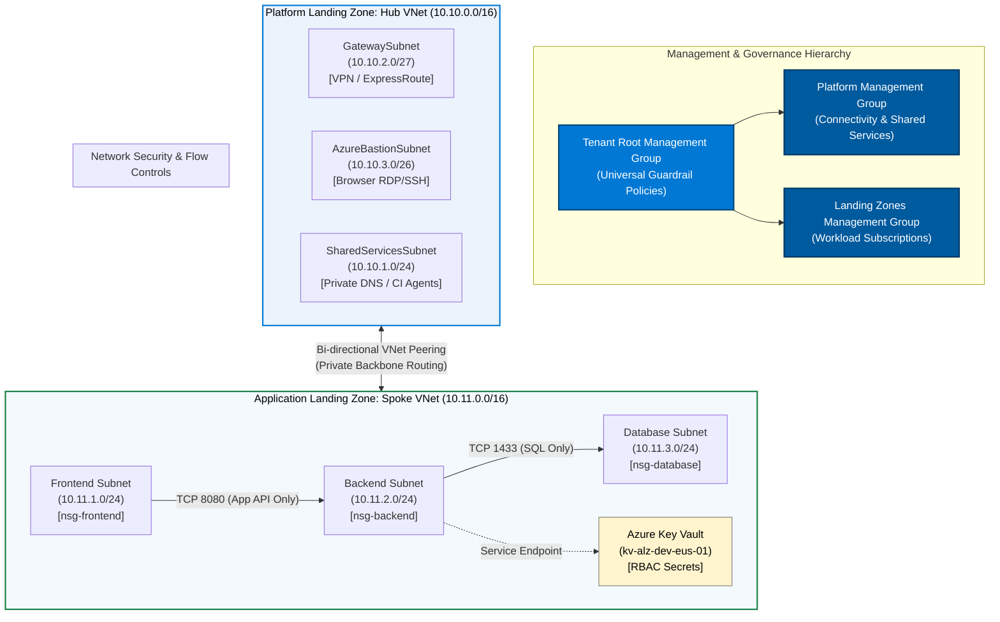

# ☁️ Azure Landing Zone Deployment Using Terraform and Azure

[](https://www.terraform.io/)
[](https://azure.microsoft.com/)
[](https://azure.microsoft.com/services/devops/)
[](https://github.com/features/actions)
[](LICENSE)

> **Portfolio Project:** Practical, enterprise-aligned implementation of an **Azure Landing Zone** using **Terraform (Infrastructure as Code)** and **Azure DevOps Multi-Stage YAML Pipelines**, adhering to the **Microsoft Cloud Adoption Framework (CAF)**.
> 
> **Author:** [Aishwarya Belekar](https://github.com/aishwaryabelekar-devops)  
> **Target Designation:** Entry-Level DevOps Engineer / Junior DevOps Engineer / DevOps Consultant  
> **Focus:** Cloud Architecture · Reusable Terraform Modules · Automated Validation Gates · Security & Governance

---

## 📌 Table of Contents

1. [Project Overview](#-project-overview)
2. [Project Objectives](#-project-objectives)
3. [Azure Landing Zone & CAF Introduction](#-azure-landing-zone--caf-introduction)
4. [Architecture Explanation & Topology](#-architecture-explanation--topology)
5. [Tools & Technologies](#-tools--technologies)
6. [Terraform Implementation & Design Patterns](#-terraform-implementation--design-patterns)
7. [Reusable Modules Breakdown](#-reusable-modules-breakdown)
8. [Multi-Environment Structuring (Dev, Test, Prod)](#-multi-environment-structuring-dev-test-prod)
9. [Azure DevOps CI/CD Pipeline Workflow](#-azure-devops-cicd-pipeline-workflow)
10. [Security, Governance & Compliance Controls](#-security-governance--compliance-controls)
11. [Project Folder Structure](#-project-folder-structure)
12. [Prerequisites](#-prerequisites)
13. [Local Setup & Validation Instructions](#-local-setup--validation-instructions)
14. [Step-by-Step Terraform Commands](#-step-by-step-terraform-commands)
15. [Pipeline Execution & Approval Gates](#-pipeline-execution--approval-gates)
16. [Expected Outputs & Verification](#-expected-outputs--verification)
17. [Troubleshooting & Common Pitfalls](#-troubleshooting--common-pitfalls)
18. [Key Learning Outcomes](#-key-learning-outcomes)
19. [Future Enhancements](#-future-enhancements)
20. [Portfolio Safety Notice](#-portfolio-safety-notice)

---

## 🚀 Project Overview

Modern enterprises migrating workloads to Microsoft Azure require a secure, repeatable, and scalable foundation before launching production applications. Building infrastructure manually via the Azure Portal leads to configuration drift, security oversights, and unmaintainable cloud sprawl.

This portfolio project demonstrates how an **Entry-Level / Junior DevOps Engineer** designs, structures, validates, and automates an enterprise **Azure Landing Zone** following the **Microsoft Cloud Adoption Framework (CAF)** principles.

By leveraging **Terraform (HCL)** for modular Infrastructure as Code and **Azure DevOps YAML** for multi-stage CI/CD pipelines, this repository provides:
- A standardized **Hub-and-Spoke network topology** with dedicated subnets for Platform and Application tiers.
- High-performance, private **VNet Peering** between Platform Hub and Application Spoke networks.
- Strict **Network Security Groups (NSGs)** enforcing tier isolation (Frontend, Backend, Database).
- Centralized secrets and key management using **Azure Key Vault** with Azure RBAC authorization.
- Reusable, parameter-driven **Terraform child modules** shared across **Dev**, **Test**, and **Prod** environments.
- Automated CI/CD validation gates with static code analysis, formatting checks, and execution plan artifacts.

---

## 🎯 Project Objectives

1. **Demonstrate Enterprise Cloud Foundations:** Model Microsoft CAF Landing Zone architecture with distinct Platform and Application scopes.
2. **Author Modular, Production-Grade Terraform:** Write DRY, parameterized child modules with rigorous input validations and output exports.
3. **Establish Multi-Environment Parity:** Structure separate configurations for Development, Testing, and Production using isolated variable files without duplicating code.
4. **Implement Deterministic CI/CD Pipelines:** Build reusable Azure DevOps YAML pipeline templates for `init`, `validate`, `plan`, and `apply` with approval gates.
5. **Practice Cloud Security & Governance:** Enforce least-privilege network rules, soft-delete key protection, standardized resource naming, and mandatory audit tags.
6. **Ensure Safe Portfolio Review:** Enable 100% offline syntax and schema validation (`terraform init -backend=false` and `terraform validate`) without incurring cloud costs or deploying unmanaged resources.

---

## 🌐 Azure Landing Zone & CAF Introduction

According to the **Microsoft Cloud Adoption Framework (CAF)**, an Azure Landing Zone is an environment for hosting workloads, pre-provisioned through code, accounting for:
- **Management Groups & Subscriptions:** Hierarchical policy inheritance and access segregation.
- **Platform Landing Zones:** Centralized shared services (firewalls, bastions, VPN gateways, management agents).
- **Application Landing Zones:** Isolated workload subscriptions where business applications run safely.
- **Governance & Baseline:** Universal policies enforcing location restrictions, encryption at rest, and audit tags.

---

## 🏛️ Architecture Explanation & Topology

The architecture separates responsibilities into a **Platform Hub** and an **Application Spoke**:



### Key Architectural Components:
1. **Hub Virtual Network (`10.10.0.0/16`):**
   - `GatewaySubnet` (`10.10.2.0/27`): Reserved for VPN Gateway or ExpressRoute termination.
   - `AzureBastionSubnet` (`10.10.3.0/26`): Provides zero-public-IP management access to VMs.
   - `SharedServicesSubnet` (`10.10.1.0/24`): Hosts shared build agents, private DNS, and monitoring collectors.
2. **Spoke Virtual Network (`10.11.0.0/16`):**
   - `Frontend Subnet` (`10.11.1.0/24`): Hosts presentation services; permits inbound HTTP (port 80) and HTTPS (port 443).
   - `Backend Subnet` (`10.11.2.0/24`): Hosts application logic APIs; permits port 8080 strictly from Frontend; blocks direct internet access.
   - `Database Subnet` (`10.11.3.0/24`): Hosts persistence tier; permits port 1433 strictly from Backend; default-deny all other inbound traffic.
3. **VNet Peering:** High-throughput, private Microsoft backbone interconnect linking Hub and Spoke networks bi-directionally without traversing public internet.
4. **Azure Key Vault:** Centralized hardware-backed secrets storage using Azure RBAC authorization and soft-delete protection.

---

## 🧰 Tools & Technologies

| Category | Technology | Version / Specification | Usage in Project |
| :--- | :--- | :--- | :--- |
| **Cloud Provider** | Microsoft Azure | Azure Cloud Adoption Framework (CAF) | Target cloud platform architecture |
| **IaC Engine** | HashiCorp Terraform | `>= 1.0.0` (Tested v1.16.5) | Declarative infrastructure definition |
| **Provider Plugin** | `hashicorp/azurerm` | `>= 3.0.0, < 5.0.0` | Azure Resource Manager API integration |
| **CI/CD Platform** | Azure DevOps Pipelines | YAML Multi-Stage Pipelines | Automated build, plan, and approval workflows |
| **Alternative CI** | GitHub Actions | YAML Workflow | Automated PR syntax & format validation |
| **Static Code Analysis** | Checkov / tfsec | Latest | Infrastructure security and compliance scanning |
| **Version Control** | Git & GitHub | Git 2.x+ | Version tracking, branching, and PR reviews |

---

## 🧱 Terraform Implementation & Design Patterns

The Terraform code follows strict enterprise software engineering practices:

* **Separation of Concerns:** Each module encapsulates a single domain (networking, security, resource groups, secrets).
* **DRY (Don't Repeat Yourself):** Child modules contain zero hardcoded environment names or IP ranges. All values are exposed as variables.
* **Variable Constraints & Validations:** Variable blocks include custom regex checks and length validations:
  ```hcl
  variable "vnet_name" {
    type        = string
    validation {
      condition     = can(regex("^[a-zA-Z0-9._-]+$", var.vnet_name))
      error_message = "VNet name may only contain letters, numbers, underscores, periods, and hyphens."
    }
  }
  ```
* **Dynamic Blocks:** Used inside the NSG module to iterate over variable security rules dynamically without duplicating resource definitions.
* **Tagging Strategy:** Merges organizational baseline tags (`ManagedBy = "Terraform"`, `Owner`, `Project`) with environment-specific metadata (`Environment = "dev"`).

---

## 📦 Reusable Modules Breakdown

The project contains five self-contained child modules in the [`modules/`](file:///c:/Users/hp/OneDrive/Desktop/aishwaryabelekar-devops/azure-landing-zone-deployment/modules) directory:

```
modules/
├── resource_group/          # Provisions Azure Resource Groups with audit tags
├── virtual_network/         # Provisions VNets with CIDR address spaces and DNS
├── subnet/                  # Provisions subnets with service endpoints
├── network_security_group/  # Provisions NSGs with dynamic security rules and associations
└── key_vault/               # Provisions Key Vaults with RBAC & soft delete
```

| Module | Core Inputs | Core Outputs | Highlights |
| :--- | :--- | :--- | :--- |
| **`resource_group`** | `name`, `location`, `tags` | `id`, `name`, `location` | Enforces length validation and standardized tagging |
| **`virtual_network`** | `vnet_name`, `address_space`, `resource_group_name` | `id`, `name`, `address_space` | Validates CIDR formats and naming conventions |
| **`subnet`** | `name`, `address_prefixes`, `virtual_network_name` | `id`, `name`, `address_prefixes` | Configures optional service endpoints (e.g., `Microsoft.KeyVault`) |
| **`network_security_group`**| `name`, `security_rules`, `subnet_id` | `id`, `name` | Generates 5-tuple security rules via `dynamic` blocks; associates to subnets |
| **`key_vault`** | `name`, `tenant_id`, `sku_name`, `soft_delete_retention_days` | `id`, `name`, `vault_uri` | Enforces Azure RBAC authorization and configurable purge protection |

---

## 🌍 Multi-Environment Structuring (Dev, Test, Prod)

Infrastructure topologies are maintained in isolated directories under [`environments/`](file:///c:/Users/hp/OneDrive/Desktop/aishwaryabelekar-devops/azure-landing-zone-deployment/environments):

```
environments/
├── dev/   # Fast-iteration development environment (relaxed retention, cost-optimized)
├── test/  # Staging / pre-production validation environment (mirrors production)
└── prod/  # Hardened production landing zone (strict NSGs, 90-day purge protection)
```

### Environment Comparison Matrix:

| Feature / Setting | Development (`dev`) | Testing (`test`) | Production (`prod`) |
| :--- | :--- | :--- | :--- |
| **Hub Address Space** | `10.10.0.0/16` | `10.20.0.0/16` | `10.30.0.0/16` |
| **Spoke Address Space** | `10.11.0.0/16` | `10.21.0.0/16` | `10.31.0.0/16` |
| **Key Vault SKU** | `standard` | `standard` | `premium` (HSM-backed) |
| **Soft Delete Retention** | 7 Days | 30 Days | 90 Days |
| **Purge Protection** | Disabled (easy cleanup) | Disabled | **Enabled** (anti-ransomware safeguard) |
| **Frontend NSG Ingress**| HTTP (80) & HTTPS (443) | HTTPS (443) Only | HTTPS (443) Only; Explicit HTTP Deny |
| **Resource Group Deletion**| Allowed if resources exist | Allowed if resources exist | **Prevented** (`prevent_deletion_if_contains_resources`) |

---

## 🔄 Azure DevOps CI/CD Pipeline Workflow

The project provides an automated, multi-stage delivery pipeline configured in [`pipelines/azure-pipelines.yml`](file:///c:/Users/hp/OneDrive/Desktop/aishwaryabelekar-devops/azure-landing-zone-deployment/pipelines/azure-pipelines.yml), composed of reusable step templates:

```
[ Developer Commit / PR ]
           |
           v
+-------------------------------------------------------------+
| Stage 1: Validation & Security                              |
| - terraform fmt -check -diff                                |
| - terraform init -backend=false                             |
| - terraform validate                                        |
| - Checkov / tfsec static security scanning                  |
+-------------------------------------------------------------+
           |
           v (Validation Passed)
+-------------------------------------------------------------+
| Stage 2: Plan Generation                                    |
| - terraform init with remote Azure Blob backend             |
| - terraform plan -var-file="terraform.tfvars" -out="tfplan" |
| - Export plain-text plan summary                            |
| - Publish plan artifact to pipeline storage                 |
+-------------------------------------------------------------+
           |
           v
+-------------------------------------------------------------+
| Stage 3: Manual Review & Approval Gate                      |
| - Target Azure DevOps Environment                           |
| - Reviewers inspect published plan summary                  |
| - Manual approval required to proceed                       |
+-------------------------------------------------------------+
           |
           v (Approved & Safety Toggle Enabled)
+-------------------------------------------------------------+
| Stage 4: Apply Changes (Safe / Example Only)                |
| - Download approved immutable tfplan artifact               |
| - Run terraform apply tfplan                                |
| - (Disabled by default for portfolio safety)                |
+-------------------------------------------------------------+
```

### Reusable Pipeline Templates:
* [`templates/terraform-init.yml`](file:///c:/Users/hp/OneDrive/Desktop/aishwaryabelekar-devops/azure-landing-zone-deployment/templates/terraform-init.yml): Installs Terraform CLI and connects to Azure Blob backend.
* [`templates/terraform-validate.yml`](file:///c:/Users/hp/OneDrive/Desktop/aishwaryabelekar-devops/azure-landing-zone-deployment/templates/terraform-validate.yml): Executes format checking, syntax validation, and Checkov scanning.
* [`templates/terraform-plan.yml`](file:///c:/Users/hp/OneDrive/Desktop/aishwaryabelekar-devops/azure-landing-zone-deployment/templates/terraform-plan.yml): Generates deterministic plan, exports text summary, and publishes artifact.
* [`templates/terraform-apply.yml`](file:///c:/Users/hp/OneDrive/Desktop/aishwaryabelekar-devops/azure-landing-zone-deployment/templates/terraform-apply.yml): Downloads plan artifact and safely executes apply with guardrails.

---

## 🔐 Security, Governance & Compliance Controls

1. **Azure RBAC & Least Privilege:**
   - Platform engineers manage Hub resources (`Network Contributor`).
   - Application teams manage Spoke resources (`Contributor`).
   - Direct secret operations require `Key Vault Secrets Officer`.
2. **Azure Policy Compliance:**
   - Restricts resource deployments to approved geographies (`eastus`).
   - Disallows public access to storage accounts and Key Vaults.
   - Enforces required resource tags at the Resource Group scope.
3. **Secure State Management:**
   - Remote `.tfstate` files are stored in an Azure Blob Storage container with 256-bit AES encryption at rest.
   - Concurrency conflicts are prevented using native Azure Blob Lease state locking.
4. **Secrets Management:**
   - Zero hardcoded passwords or API keys in git.
   - Application workloads access secrets via Azure Managed Identities and Private Service Endpoints.

---

## 📁 Project Folder Structure

```
azure-landing-zone-deployment/
│
├── environments/                     # Multi-environment root configurations
│   ├── dev/
│   │   ├── backend.tf                # Azure Blob remote backend example
│   │   ├── locals.tf                 # Naming prefix and tag calculations
│   │   ├── main.tf                   # Dev landing zone calling child modules
│   │   ├── outputs.tf                # Exported IDs, names, and URIs
│   │   ├── providers.tf              # AzureRM provider configuration
│   │   ├── terraform.tfvars          # Dev variable assignments (safe sample)
│   │   └── variables.tf              # Dev input variable definitions
│   ├── test/
│   │   ├── backend.tf
│   │   ├── locals.tf
│   │   ├── main.tf
│   │   ├── outputs.tf
│   │   ├── providers.tf
│   │   ├── terraform.tfvars
│   │   └── variables.tf
│   └── prod/
│       ├── backend.tf
│       ├── locals.tf
│       ├── main.tf
│       ├── outputs.tf
│       ├── providers.tf
│       ├── terraform.tfvars
│       └── variables.tf
│
├── modules/                          # Reusable, parameterized child modules
│   ├── resource_group/               # Azure Resource Group module
│   │   ├── main.tf
│   │   ├── outputs.tf
│   │   └── variables.tf
│   ├── virtual_network/              # Azure Virtual Network module
│   │   ├── main.tf
│   │   ├── outputs.tf
│   │   └── variables.tf
│   ├── subnet/                       # Azure Subnet module
│   │   ├── main.tf
│   │   ├── outputs.tf
│   │   └── variables.tf
│   ├── network_security_group/       # Network Security Group module
│   │   ├── main.tf
│   │   ├── outputs.tf
│   │   └── variables.tf
│   └── key_vault/                    # Azure Key Vault module
│       ├── main.tf
│       ├── outputs.tf
│       └── variables.tf
│
├── templates/                        # Reusable Azure DevOps YAML step templates
│   ├── terraform-init.yml            # Step template for terraform init & backend
│   ├── terraform-validate.yml        # Step template for format, validate & scan
│   ├── terraform-plan.yml            # Step template for plan generation & artifacts
│   └── terraform-apply.yml           # Step template for safe execution & apply
│
├── pipelines/
│   └── azure-pipelines.yml           # Main Azure DevOps multi-stage pipeline definition
│
├── docs/                             # In-depth architectural & technical documentation
│   ├── architecture.md               # Architecture guide with Mermaid diagrams
│   ├── azure-landing-zone.md         # CAF principles, design areas & components
│   ├── terraform-guide.md            # Terraform fundamentals, lifecycle & state
│   ├── azure-governance.md           # Management groups, RBAC, policy & locks
│   └── troubleshooting.md            # Common Terraform & CI/CD error solutions
│
├── examples/
│   ├── terraform-commands.md         # Daily CLI commands reference for junior engineers
│   └── sample-plan-output.txt        # Illustrative terraform plan output
│
├── .github/
│   └── workflows/
│       └── terraform-validation.yml  # GitHub Actions automated PR validation workflow
│
├── .gitignore                        # Comprehensive ignores for state, plans & secrets
└── README.md                         # Primary project documentation
```

---

## 📋 Prerequisites

To explore, validate, or customize this project locally:

1. **Git:** Version 2.x or higher installed ([Download Git](https://git-scm.com/))
2. **Terraform CLI:** Version 1.0.0 or higher ([Download Terraform](https://www.terraform.io/downloads))
3. **Azure CLI (Optional for live deployments):** Version 2.40+ ([Download Azure CLI](https://learn.microsoft.com/cli/azure/install-azure-cli))
4. **Code Editor:** Visual Studio Code with the HashiCorp Terraform extension installed.

---

## 💻 Local Setup & Validation Instructions

Follow these steps to validate the configurations locally on your machine without requiring any Azure subscription or credentials:

### 1. Clone the Repository
```bash
git clone https://github.com/aishwaryabelekar-devops/aishwaryabelekar-devops.git
cd aishwaryabelekar-devops/azure-landing-zone-deployment
```

### 2. Verify Canonical Code Formatting
```bash
terraform fmt -check -diff -recursive .
```
*Expected result:* Exits with code `0`, confirming all configuration files adhere to standard formatting.

### 3. Initialize and Validate Any Child Module
```bash
cd modules/resource_group
terraform init -backend=false
terraform validate
cd ../..
```
*Expected result:*
```text
Success! The configuration is valid.
```

### 4. Initialize and Validate Any Environment (Dev, Test, Prod)
```bash
cd environments/dev
terraform init -backend=false
terraform validate
cd ../..
```
*Expected result:*
```text
Success! The configuration is valid.
```

---

## 🛠️ Step-by-Step Terraform Commands

For day-to-day operations, review the detailed reference in [`examples/terraform-commands.md`](file:///c:/Users/hp/OneDrive/Desktop/aishwaryabelekar-devops/azure-landing-zone-deployment/examples/terraform-commands.md):

```bash
# Navigate to desired environment
cd environments/dev

# 1. Initialize working directory (offline)
terraform init -backend=false

# 2. Check code formatting
terraform fmt -check

# 3. Validate syntax and argument types
terraform validate

# 4. Preview execution plan with variable assignments
terraform plan -var-file="terraform.tfvars"

# 5. Save execution plan for deterministic review
terraform plan -var-file="terraform.tfvars" -out="tfplan"

# 6. Inspect plain text summary of saved plan
terraform show -no-color tfplan
```

---

## 🚀 Pipeline Execution & Approval Gates

When running the Azure DevOps pipeline:
1. **Trigger:** A pull request or push to `main` or `develop` triggers **Stage 1 (Validation & Security)**.
2. **Plan Generation:** If validation passes, **Stage 2 (Plan Generation)** authenticates via an ARM Service Connection, runs `terraform plan`, and uploads the plan artifact.
3. **Approval Gate:** The pipeline pauses at **Stage 3 (Manual Approval)**. Reviewers inspect the uploaded plan artifact and click "Approve" with audit notes.
4. **Apply (Guarded):** If approved and the safety parameter `enableApply` is set to `true`, **Stage 4** executes `terraform apply`. By default, this is disabled to prevent accidental cloud spend.

---

## 📊 Expected Outputs & Verification

When running `terraform plan` on the Development environment, Terraform proposes creating **16 cloud resources**:

```text
Plan: 16 to add, 0 to change, 0 to destroy.

Changes to Outputs:
  + hub_resource_group_name   = "rg-hub-alz-dev-eus"
  + hub_vnet_name             = "vnet-hub-alz-dev-eus"
  + spoke_resource_group_name = "rg-spoke-alz-dev-eus"
  + spoke_vnet_name           = "vnet-spoke-alz-dev-eus"
  + key_vault_name            = "kv-alz-dev-eus-01"
  + peering_ids               = { hub_to_spoke = ..., spoke_to_hub = ... }
  + subnet_ids                = { hub_shared = ..., spoke_frontend = ..., ... }
```

A complete illustrative execution plan output is available in [`examples/sample-plan-output.txt`](file:///c:/Users/hp/OneDrive/Desktop/aishwaryabelekar-devops/azure-landing-zone-deployment/examples/sample-plan-output.txt).

---

## 🔧 Troubleshooting & Common Pitfalls

For full step-by-step solutions to common errors, refer to [`docs/troubleshooting.md`](file:///c:/Users/hp/OneDrive/Desktop/aishwaryabelekar-devops/azure-landing-zone-deployment/docs/troubleshooting.md):

| Issue | Common Cause | Quick Resolution |
| :--- | :--- | :--- |
| **`LeaseAlreadyPresent`** | Prior pipeline was killed abruptly | Run `terraform force-unlock <LOCK_ID>` or break lease in Azure portal |
| **`Subnet CIDR Overlap`** | Identical IP prefixes assigned | Adjust CIDRs in `terraform.tfvars` so each tier uses unique subnets |
| **`Key Vault Name Conflict`** | Name exists in another tenant worldwide | Change the name variable to include a unique project/team suffix |
| **`ARM Service Connection Error`** | Connection not authorized | In Azure DevOps Project Settings, grant pipeline permissions to the connection |
| **`terraform fmt check failed`** | Indentation or whitespace drift | Run `terraform fmt -recursive` locally before committing to git |

---

## 💡 Key Learning Outcomes

Through building and validating this project, key foundational DevOps competencies were established:

1. **Enterprise Cloud Organization:** Mastered the relationship between Tenant Root Management Groups, Subscriptions, Resource Groups, and Network Segmentation in Microsoft Azure.
2. **Modular IaC Architecture:** Gained proficiency writing reusable Terraform child modules with dynamic blocks, explicit variable validation blocks, and output exports.
3. **CI/CD Best Practices:** Learned how to structure reusable Azure DevOps YAML pipeline step templates, enforce validation stages, and implement manual approval gates.
4. **State Management & Locking:** Understood the critical importance of remote backend state storage in Azure Blob Storage with Blob Lease locking for concurrent team workflows.
5. **Security by Default:** Implemented defense-in-depth principles: zero public IP exposure for backend/database tiers, strict NSG ordering, and Key Vault RBAC authorization.

---

## 🔮 Future Enhancements

Potential extensions to explore as cloud experience grows:
- [ ] Implement **Azure Firewall** and **User Defined Routes (UDRs)** to route spoke-to-spoke traffic through a central inspection appliance.
- [ ] Integrate **Azure Private DNS Resolver** to support automated split-horizon private endpoint resolution across hybrid networks.
- [ ] Add automated compliance scanning into CI/CD using **Open Policy Agent (OPA) / Rego** or **Infracost** for cloud cost estimations on PRs.
- [ ] Automate multi-region active-passive Disaster Recovery replication for storage and databases.

---

## ⚠️ Portfolio Safety Notice

> **IMPORTANT:** This repository is a learning and portfolio project. No real cloud infrastructure is modified or destroyed during automated pull request validations. All variable files use safe, non-sensitive mock placeholders. In production environments, sensitive values and service principal secrets are injected dynamically via secure Azure DevOps Variable Groups and Key Vault task integrations.

---

## 👩‍💻 Author & Connect

**Aishwarya Belekar**  
*Entry-Level DevOps Engineer · Azure Cloud · Terraform · CI/CD Pipelines*  

- 🐙 **GitHub:** [@aishwaryabelekar-devops](https://github.com/aishwaryabelekar-devops)  
- 💼 **LinkedIn:** [Connect with me](https://www.linkedin.com/)  
- 📧 **Email:** [aishwarya.belekar.work@gmail.com](mailto:aishwarya.belekar.work@gmail.com)
