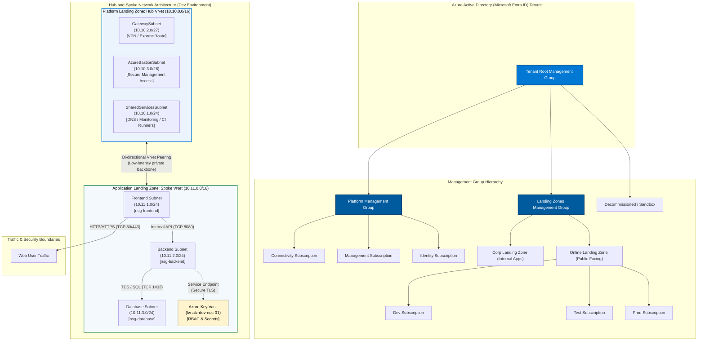

# 🏛️ Azure Landing Zone Architecture Guide

This document details the architectural foundation of the **Azure Landing Zone Deployment** portfolio project, designed in alignment with the **Microsoft Cloud Adoption Framework (CAF)**.

---

## 📌 Executive Summary

An **Azure Landing Zone** is the output of a multi-subscription cloud environment that accounts for scale, security, governance, networking, and identity. It enables application migration, modernization, and innovation at enterprise scale in Microsoft Azure.

This implementation demonstrates an enterprise-grade **Hub-and-Spoke network topology** separated into a **Platform Landing Zone** (central connectivity and shared services) and an **Application Landing Zone** (isolated multi-tier application workloads).

---

## 📐 High-Level Architecture Diagram

The diagram below illustrates the hierarchical management tree, resource grouping, network topology, and security perimeters:



---

## 🏛️ Architectural Layers Breakdown

### 1. Management Group & Subscription Organization
Management groups provide a governance scope above subscriptions. Policies and role assignments applied at the root or intermediate management group levels inherit downward to all child subscriptions.

| Scope | Purpose | Guardrails Applied |
| :--- | :--- | :--- |
| **Tenant Root Group** | Top-level parent for all enterprise subscriptions. | Baseline security policies: enforce encryption at rest, disallow public storage accounts, require mandatory tags (`Environment`, `CostCenter`, `Owner`). |
| **Platform Management Group** | Houses foundational shared platform services. | Restricted access: Only platform and network engineering teams have contributor rights. |
| **Landing Zones Management Group** | Contains business workload subscriptions segregated into Corp (private) and Online (public). | Workload policies: Restrict allowed VM SKUs, restrict deployment to approved Azure regions (`eastus`, `centralus`). |

---

### 2. Platform Landing Zone (Hub Network)
The **Hub Virtual Network (`10.10.0.0/16`)** acts as the central point of connectivity and administrative control:

* **GatewaySubnet (`10.10.2.0/27`):** Reserved for Azure Virtual Network Gateway or ExpressRoute Gateway to terminate cross-premises IPsec tunnels securely.
* **AzureBastionSubnet (`10.10.3.0/26`):** Dedicated to Azure Bastion, enabling browser-based RDP and SSH connectivity directly to backend virtual machines without exposing public IP addresses.
* **SharedServicesSubnet (`10.10.1.0/24`):** Hosts shared infrastructure tooling such as private DNS resolvers, domain controllers, Azure DevOps self-hosted build agents, and monitoring forwarders.

---

### 3. Application Landing Zone (Spoke Network)
The **Spoke Virtual Network (`10.11.0.0/16`)** hosts the application workload isolated from other workloads:

* **3-Tier Segmentation Model:**
  * **Frontend Tier (`10.11.1.0/24`):** Hosts presentation layer components or reverse proxies. Protected by `nsg-frontend`.
  * **Backend Tier (`10.11.2.0/24`):** Hosts application runtime APIs, microservices, and compute nodes. Protected by `nsg-backend`.
  * **Database Tier (`10.11.3.0/24`):** Isolated persistence tier hosting managed SQL databases or storage. Protected by `nsg-database`.
* **Zero Public IP Exposure for Backend/Database:** Neither the backend nor the database tier possesses public IP addresses. Outbound calls route through the Hub, and inbound calls are strictly governed by NSGs.

---

### 4. Interconnectivity: Hub-and-Spoke VNet Peering
Connectivity between the Hub and Spoke is established using native **Azure Virtual Network Peering**:
* **High Bandwidth, Low Latency:** Peering traffic stays entirely within the private Microsoft global backbone network without traversing the public internet.
* **Bi-directional Peering:** Two peering resources are created (`hub_to_spoke` and `spoke_to_hub`) to allow symmetric stateful packet delivery.
* **Gateway Transit Support:** Spokes can leverage VPN gateways in the Hub without needing dedicated gateway hardware deployed per application spoke.

---

### 5. Security & Isolation Controls

```
+-----------------------------------------------------------------------------------+
|                            INTERNET / CONSUMERS                                   |
+-----------------------------------------------------------------------------------+
                                         |
                                (Port 80 / 443 Only)
                                         v
+-----------------------------------------------------------------------------------+
|  FRONTEND SUBNET (10.11.1.0/24)                                                   |
|  - NSG Rule: Allow TCP 80 & 443 Inbound                                           |
|  - NSG Rule: Deny direct outbound to Database Subnet                              |
+-----------------------------------------------------------------------------------+
                                         |
                                (Port 8080 API Only)
                                         v
+-----------------------------------------------------------------------------------+
|  BACKEND SUBNET (10.11.2.0/24)                                                    |
|  - NSG Rule: Allow TCP 8080 strictly from 10.11.1.0/24                            |
|  - NSG Rule: Deny ALL direct Inbound from 'Internet' Tag                          |
|  - Service Endpoint enabled for 'Microsoft.KeyVault'                              |
+-----------------------------------------------------------------------------------+
                                         |
                                (Port 1433 SQL Only)
                                         v
+-----------------------------------------------------------------------------------+
|  DATABASE SUBNET (10.11.3.0/24)                                                   |
|  - NSG Rule: Allow TCP 1433 strictly from 10.11.2.0/24                            |
|  - NSG Rule: Deny All other inbound traffic (Priority 4096)                       |
+-----------------------------------------------------------------------------------+
```

---

## 📈 Multi-Region Expansion Strategy

When expanding this Landing Zone to secondary regions (e.g., Disaster Recovery in `westus`):
1. Re-run the Hub VNet module targeting the secondary region (`10.40.0.0/16`).
2. Establish Global VNet Peering between the primary Hub (`eastus`) and secondary Hub (`westus`).
3. Connect local Spoke VNets in each respective geography to the local regional Hub.
4. Synchronize Private DNS zones across both regions using Azure Private DNS Resolver.
